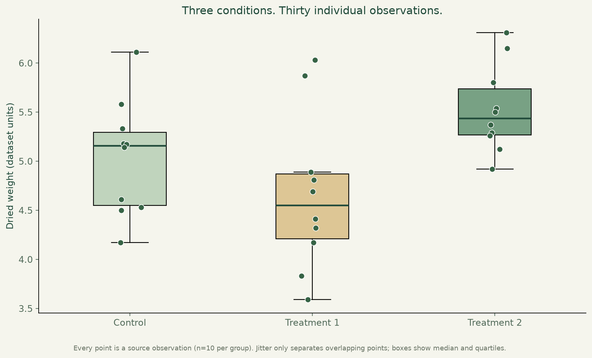
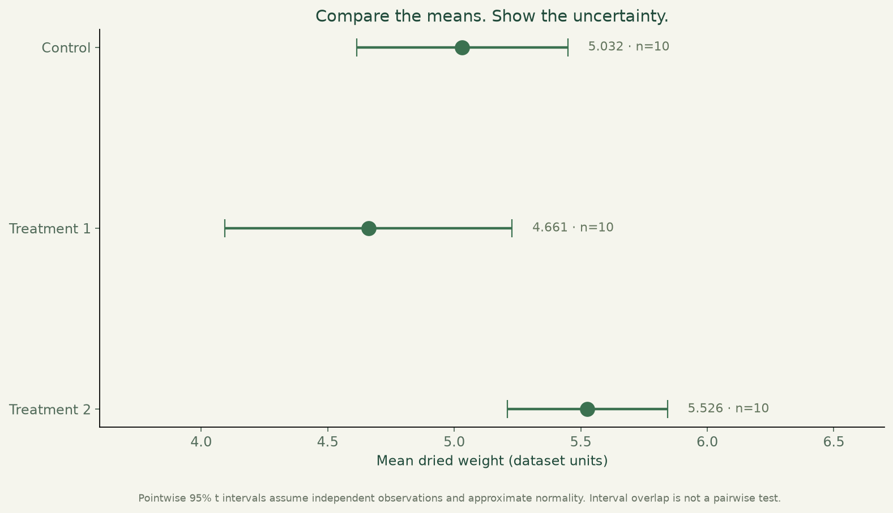
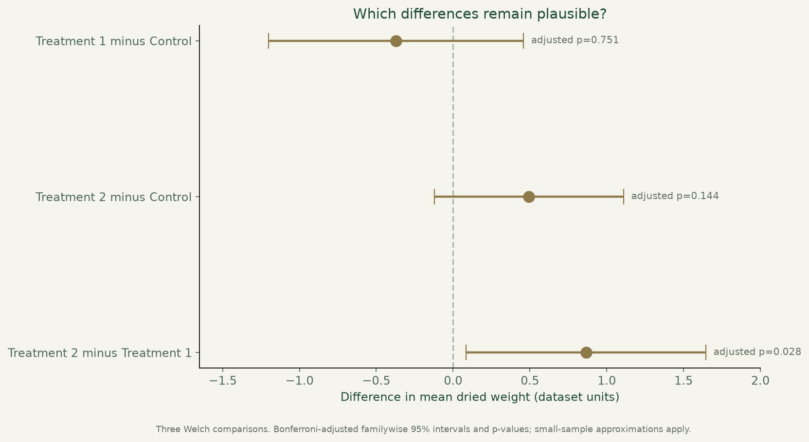

# Plant growth & statistics

Thirty observations, three growing conditions, and a careful look at differences and uncertainty.



**Python · pandas · SciPy · Matplotlib · Statistical inference**

[Visual case study](https://benjanning.github.io/projects/projects/applied-statistics/) · [Portfolio](https://benjanning.github.io/projects/)

## What the analysis shows

The sample contains ten dried-weight measurements for each of a control and two treatment conditions. Every observation is visible. The treatment means differ in this sample, but statistical evidence does not establish general effectiveness or say that every pair differs.



The mean plot uses pointwise 95% t intervals. Their overlap is not a pairwise significance test. Welch one-way ANOVA is the primary omnibus comparison; the classic equal-variance result is shown separately as sensitivity analysis, rather than selecting whichever gives a smaller p-value.



Three two-sided Welch comparisons use a Bonferroni adjustment. The plotted difference intervals are familywise 95% Welch approximations; they are distinct from the pointwise mean intervals above. A p-value measures compatibility with a model, not the chance that a hypothesis is true, practical importance or a causal treatment effect.

## Reproduce and inspect

```bash
python -m pip install -r requirements.txt
python analyze_plants.py
python -m unittest discover -p "test_*.py" -v
```

Three tests reconcile classic ANOVA with an independent sums-of-squares calculation, check group summaries and multiplicity adjustment, and reproduce the numeric outputs exactly. Inspect [analysis.json](results/analysis.json), [group-summary.csv](results/group-summary.csv) and [pairwise-comparisons.csv](results/pairwise-comparisons.csv). The source hash and environment versions are recorded.

## Context and limits

The preserved [PlantGrowth.csv](PlantGrowth.csv) is the R teaching dataset documented by [R's datasets manual](https://stat.ethz.ch/R-manual/R-devel/library/datasets/html/PlantGrowth.html), which identifies Dobson's statistical modelling text as its source. Weight units are left as dataset units; grams are not invented. The original design and independence cannot be verified from this CSV, n=10 per group is small, and normality/variance assumptions matter. Methods were selected for educational analysis, not preregistered confirmation.

The original `project.ipynb` and its other statistical exercises remain intact. The new script complements that coursework with a compact reproducible presentation. Source CI verifies computation and exports commit-identified figures and its computed result summary to the central portfolio's review-PR process.

[Original coursework and references](COURSEWORK.md) · [Visual provenance](assets/PROVENANCE.md)
