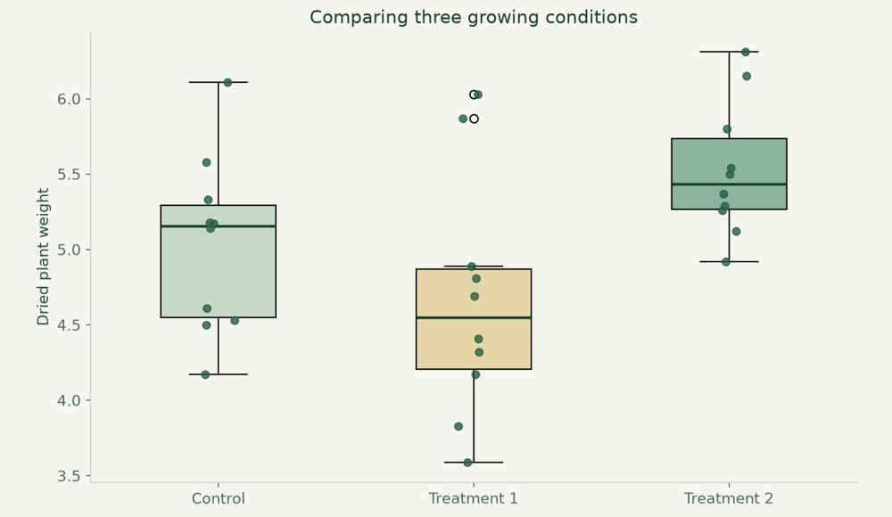

# Plant growth & statistics

Compare plant-growth treatments using visual exploration and statistical inference.



**Python · SciPy · statsmodels · pandas**

[Visual case study](https://benjanning.github.io/projects/projects/applied-statistics/) · [Main portfolio](https://benjanning.github.io/projects/)

## What it does

Analysed the PlantGrowth teaching dataset using distribution plots, assumption checks, group comparisons and follow-up tests.

## Key features

- Distribution plots with the underlying observations.
- Normality and variance checks, t-tests and one-way ANOVA.
- Tukey follow-up comparisons and a non-parametric alternative.

## Explore the analysis

```bash
python -m pip install -r requirements.txt
```
Open project.ipynb in a Jupyter interface from the repository root. PlantGrowth.csv is included. Jupyter’s interface is installed separately; the requirements provide the tested analysis packages and kernel.

## Technical details and verification

The project notebook executed all 18 code cells in V1. The chart above is a new presentation of the same 30 included observations, not a new experiment. Statistical significance does not establish practical importance. Independence depends on study design; distribution checks cannot prove it. tasks.ipynb is supporting coursework and was not fully rerun.

[Original documentation and academic references](COURSEWORK.md) · [Visual provenance](assets/PROVENANCE.md)
